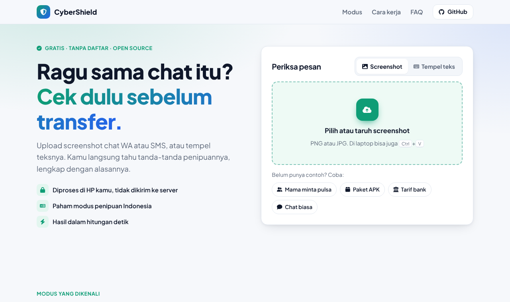
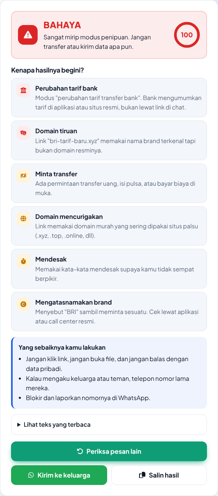

<div align="center">

# 🛡️ CyberShield Nexus

**Cek apakah pesan WA/SMS itu penipuan. Upload screenshot atau tempel teksnya, langsung keluar tanda bahayanya beserta alasannya.**

[**➡️ Coba sekarang: scam-detector-sece.vercel.app**](https://scam-detector-sece.vercel.app)


[English](#english) · [Cara pakai](#cara-pakai) · [Modus yang dikenali](#modus-yang-dikenali) · [Kontribusi](#kontribusi)



</div>

## Kenapa dibuat

"Ma, ini aku, ganti nomor." File `Foto_Paket.apk` dari "kurir". Link `bri-tarif-baru.xyz`. Hampir semua orang Indonesia pernah menerima pesan seperti ini, dan banyak alat pendeteksi scam yang ada hanya mengerti bahasa Inggris.

CyberShield Nexus membaca teks di screenshot dengan [Tesseract.js](https://github.com/naptha/tesseract.js), lalu mencocokkannya dengan pola modus penipuan yang sering beredar di Indonesia. Hasilnya bukan cuma "aman" atau "bahaya", tapi juga **alasannya**, supaya kamu belajar mengenali modusnya sendiri.



## Fitur

- **Upload screenshot** chat WA, SMS, email, atau DM, dan teksnya dibaca otomatis (bahasa Indonesia + Inggris)
- **Tempel teks** langsung kalau lebih praktis
- **Skor risiko 0–100** dengan penjelasan per tanda bahaya
- **Cek link**: link pendek, domain murah (.xyz, .top, dll), dan domain tiruan bank atau e-commerce
- **Privat**: semua proses terjadi di browser, tidak ada screenshot atau teks yang dikirim ke server
- **Bagikan hasil** ke WA keluarga dengan satu klik

## Cara pakai

1. Buka [scam-detector-bay.vercel.app](https://scam-detector-bay.vercel.app)
2. Taruh screenshot pesannya, atau tempel teksnya lalu klik **Periksa Teks**
3. Baca bagian **"Kenapa Hasilnya Begini?"**

Pemeriksaan screenshot pertama perlu mengunduh data bahasa OCR (sekitar 10 MB), jadi agak lama. Pemeriksaan berikutnya jauh lebih cepat.

## Modus yang dikenali

| Modus | Contoh |
|---|---|
| Mengaku keluarga / ganti nomor | "Ma, ini aku. HP lama rusak, isiin pulsa dulu" |
| File APK | "Cek foto paket: Lihat_Paket.apk", undangan nikah .apk, surat tilang .apk |
| Minta kode OTP | "Kirimkan kode OTP yang masuk ke SMS anda" |
| Minta data rahasia | PIN, password, CVV, foto KTP, nama ibu kandung |
| Perubahan tarif bank | "Tarif transfer baru Rp150.000/bulan, isi form di …" |
| Hadiah / undian | "Nomor anda terpilih sebagai pemenang undian" |
| Kerja paruh waktu | "Like & follow dibayar Rp50rb per tugas" |
| Investasi untung pasti | "Profit dijamin 30% per bulan" |
| Pinjaman instan | "Pinjaman cair tanpa jaminan" |
| Salah transfer | "Saya salah transfer, tolong kembalikan dana" |
| Ancaman blokir akun | "Akun anda akan dinonaktifkan" |
| Link mencurigakan | bit.ly, s.id, domain .xyz/.top, `bca-verifikasi.com` |

Daftar lengkapnya ada di [`detector.js`](detector.js).

## Batasan

Ini pendeteksi berbasis pola, bukan AI yang memahami isi pesan. Penipu yang memakai kata-kata baru bisa lolos, dan pesan normal yang kebetulan mirip modus bisa ikut ditandai. Anggap hasilnya sebagai peringatan awal. Kalau ragu, hubungi orangnya lewat nomor lama atau call center resmi, dan cek rekening tujuan di [cekrekening.id](https://cekrekening.id).

## Jalankan sendiri

Tidak perlu install apa pun karena semuanya file statis.

```bash
git clone https://github.com/bramcps/ai-scam-detector.git
cd ai-scam-detector
python -m http.server 8000
# buka http://localhost:8000
```

Menjalankan tes pendeteksi (butuh Node.js 18+):

```bash
node --test
```

## Struktur

```
index.html          halaman utama
styles.css          tampilan
script.js           upload, OCR, dan menampilkan hasil
detector.js         mesin pendeteksi (semua pola ada di sini)
tests/              tes untuk detector.js
python-prototype/   versi awal berbasis Streamlit + Naive Bayes (eksperimen, tidak dipakai website)
```

## Kontribusi

Paling dibutuhkan: **pola modus baru**. Pernah dapat pesan penipuan yang lolos? Ada dua cara membantu:

- **Tanpa ngoding**: buka [issue baru](https://github.com/bramcps/ai-scam-detector/issues/new) dan tempel isi pesannya. Hapus dulu nama dan nomor asli.
- **Dengan ngoding**: tambahkan pola di `RULES` dalam `detector.js`, tambahkan contoh pesannya di `tests/detector.test.js`, pastikan `node --test` lolos, lalu kirim pull request.

Detailnya ada di [CONTRIBUTING.md](CONTRIBUTING.md).

## English

**CyberShield Nexus** is a free, open-source scam message checker focused on Indonesian WhatsApp/SMS scams. Drop a screenshot or paste the text: it runs OCR in the browser with Tesseract.js, scores the message against known scam patterns (fake family member, APK files, OTP requests, bank fee hoaxes, fake prizes, task scams, lookalike domains, and more), and explains every red flag. Nothing leaves your device. Contributions of new scam patterns are very welcome; see [CONTRIBUTING.md](CONTRIBUTING.md).

## Lisensi

[MIT](LICENSE) © 2025 Mas Bram

Kalau proyek ini bermanfaat, kasih ⭐ supaya lebih banyak orang menemukannya.
